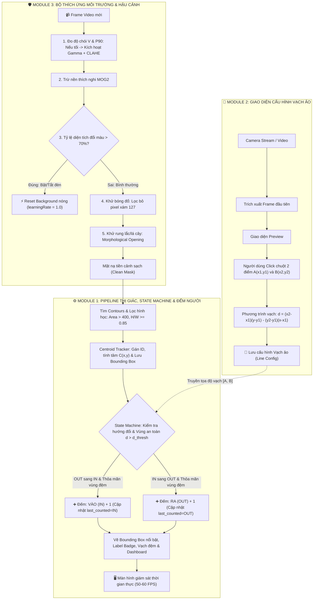

# ĐỒ ÁN MÔN HỌC: XỬ LÝ ẢNH (DIGITAL IMAGE PROCESSING)
**Học viện Công nghệ Bưu chính Viễn thông (PTIT HCM)**  
**Giảng viên phụ trách:** TS. Huỳnh Trung Trụ  
**Hình thức thực hiện:** Đồ án cá nhân (1 Sinh viên)

---

## 📌 TÊN ĐỀ TÀI ĐỀ XUẤT (Chọn để đăng ký vào Excel)

* **Tên chính thức (Khuyên dùng nhất - Chuẩn học thuật & Thực tiễn):**  
  👉 `Hệ thống camera giám sát thông minh: Theo dõi, đếm người qua lại và thích ứng môi trường dựa trên xử lý ảnh`
* **Tên ngắn gọn:**  
  👉 `Phát hiện, theo dõi và đếm người qua lại từ video camera giám sát`
* **Tên nhấn mạnh kỹ thuật:**  
  👉 `Ứng dụng kỹ thuật trừ nền thích nghi, hình thái học và theo dõi đối tượng trong giám sát an ninh`

---

## 1. TỔNG QUAN HỆ THỐNG (KIẾN TRÚC 3 MODULES CỐT LÕI)

Hệ thống được thiết kế theo dạng **Bộ giải pháp giám sát an ninh thông minh (Smart Vision Surveillance)** thuần Xử lý ảnh (**Pure DIP - Không cần AI / Không cần Dataset huấn luyện**), tối ưu hóa gọn gàng cho 1 sinh viên thực hiện với **3 Modules chuyên sâu**:

```
┌──────────────────────────────────────────────────────────────────────────────────────────────────┐
│                                HỆ THỐNG GIÁM SÁT THÔNG MINH (3 MODULES)                          │
├──────────────────────────────────────────────────────────────────────────────────────────────────┤
│ 🔹 MODULE 1: PIPELINE THỊ GIÁC, STATE MACHINE & ĐẾM NGƯỜI (Core Vision & Smart Tracking)         │
│    • Trừ nền thích nghi MOG2 + Phân đoạn dáng người (Area, Aspect Ratio H/W >= 0.85)             │
│    • Centroid Tracker + Máy trạng thái động (State Machine: direction, last_counted)             │
│    • Vùng đệm an toàn d > d_threshold: Chống đếm sai khi người đi qua đi lại / chần chừ quanh vạch│
│    • Bounding Box trực quan nổi bật: Hiển thị ID, Trạng thái (IN/OUT), Tâm và Quỹ đạo chuyển động │
│                                                                                                  │
│ 🔹 MODULE 2: GIAO DIỆN CẤU HÌNH VẠCH ẢO TƯƠNG TÁC CHUỘT (Interactive Virtual Tripwire GUI)      │
│    • Người dùng click chọn 2 điểm A(x1,y1) và B(x2,y2) trực tiếp trên màn hình xem trước        │
│    • Tự động tính toán phương trình vạch phân cách và truyền tọa độ vào Module 1                 │
│                                                                                                  │
│ 🔹 MODULE 3: BỘ THÍCH ỨNG MÔI TRƯỜNG & QUẢN LÝ HẬU CẢNH (Adaptive Environment & Background)      │
│    1. Xử lý đổi sáng đột ngột (Bật/Tắt đèn)     ──► Fast Background Reset (learningRate = 1.0)   │
│    2. Xử lý chu kỳ ngày - đêm (Thiếu sáng)      ──► Adaptive Gamma Correction + CLAHE            │
│    3. Cơ chế đồng hóa đồ vật di dời             ──► Background Absorption (Đồng hóa qua time)    │
│    4. Khử bóng đổ người trên sàn                ──► Shadow Removal (Loại bỏ pixel bóng xám 127)  │
│    5. Khử rung lắc môi trường & Vi chuyển động ──► Morphological Opening + Area Filtering       │
└──────────────────────────────────────────────────────────────────────────────────────────────────┘
```

---

## 2. BẢNG ÁNH XẠ KIẾN THỨC VỚI 14 SLIDE BÀI GIẢNG CỦA THẦY HUỲNH TRUNG TRỤ

| STT | Khối Module | Slide tương ứng | Thuật toán & Công thức Toán học cốt lõi |
| :---: | :--- | :--- | :--- |
| **1** | **Xử lý thiếu sáng ban đêm (Module 3)** | **Slide 2, 4, 5** *(Point Ops, Histograms, Color)* | Biến đổi Gamma thích nghi $s = c \cdot r^\gamma$ ($\gamma < 1.0$), Cân bằng tương phản cục bộ **CLAHE**, Đo độ chói chuẩn trên không gian **HSV / Y**. |
| **2** | **Trừ nền phát hiện chuyển động (Module 1 & 3)** | **Slide 3** *(Combining Images, p. 4-5)* | **Adaptive Background Subtraction**: $B_t = \alpha B_{t-1} + (1-\alpha)I_t$, Sai phân $|I_t - B_t| > \theta$, Cơ chế **Background Absorption**. |
| **3** | **Khử bóng đổ & Rung lắc (Module 3)** | **Slide 5 & Slide 7** *(Color, Morphology)* | Phân tích tính bất biến màu sắc $H, S$ trong HSV để lọc bóng xám ($127$); **Morphological Opening** $(A \ominus B) \oplus B$ xóa nhiễu lá cây. |
| **4** | **Phân đoạn & Lọc dáng người (Module 1)** | **Slide 6** *(Segmentation, p. 26-35)* | **Connected Components & Region Moments**: Lọc theo diện tích $Area > 400$ và tỷ lệ dáng người đứng $Height / Width \ge 0.85$. |
| **5** | **Bộ theo dõi tâm đối tượng (Module 1)** | **Slide 6** *(Region Moments, p. 35)* | Tính tâm $C(x, y) = (\frac{M_{10}}{M_{00}}, \frac{M_{01}}{M_{00}})$, Ma trận khoảng cách Euclidean để gán và duy trì $ID$. |
| **6** | **Máy trạng thái & Cắt vạch an toàn (Module 1 & 2)** | **Hình học giải tích & State Machine** | **Tích có hướng & Khoảng cách trực giao**: Xác định dấu chuyển dịch kết hợp **Vùng đệm an toàn $d > d_{threshold}$** và State Machine (`direction`, `last_counted`) chống đếm lặp khi qua lại gần vạch. |

---

## 3. SƠ ĐỒ KIẾN TRÚC HỆ THỐNG (SYSTEM ARCHITECTURE)



---

## 4. CHI TIẾT 5 CƠ CHẾ THÍCH ỨNG TRONG MODULE 3

### 4.1. Xử lý Thay đổi ánh sáng đột ngột (Bật/Tắt đèn toàn phòng)
* **Hiện tượng:** Khi công tắc bật/tắt, cường độ phòng đổi đột ngột làm toàn màn hình bị trắng xóa ($>70\%$ diện tích).
* **Giải thuật:** Khi $\frac{\text{Count}(Mask == 255)}{\text{Total Pixels}} > 0.70$, hệ thống nhận diện là **Global Illumination Change**, lập tức kích hoạt cập nhật nóng `bg_subtractor.apply(frame, learningRate=1.0)` $\Rightarrow$ Màn hình đen sạch lại ngay sau 1 frame!

### 4.2. Xử lý Chu kỳ Ngày - Đêm (Thiếu sáng / Ban đêm)
* **Hiện tượng:** Trời tối làm tương phản thấp, camera nhiều nhiễu hạt ISO.
* **Giải thuật:** Đo độ sáng trung bình $L_{env}$ trên vùng tĩnh. Nếu $L_{env} < 75$, tự động tính:
  $$\gamma = 0.35 + 0.55 \times \left(\frac{L_{env}}{75}\right)$$
  Áp dụng **Gamma Correction** qua bảng LUT và **CLAHE** để kéo sáng và giữ sắc nét đường biên.

### 4.3. Cơ chế Đồng hóa Đồ vật di dời (Background Absorption)
* **Hiện tượng:** Đồ vật trong nhà (ghế, thùng hàng) bị dời sang vị trí mới.
* **Giải thuật:** Dựa vào công thức thích nghi $B_t = \alpha B_{t-1} + (1-\alpha)I_t$. Sau một khoảng thời gian ($15-30$ giây), đồ vật đứng yên sẽ **tự động hòa tan thành Nền Mới**. Đồng thời bộ lọc vận tốc $v = 0$ ngăn chặn không đếm nhầm đồ vật.

### 4.4. Khử bóng đổ người di chuyển (Shadow Removal)
* **Hiện tượng:** Bóng đen in trên sàn nhà bị dính liền vào người, làm lệch tâm và đếm sai.
* **Giải thuật:** MOG2 phân tích tính bất biến màu sắc trong HSV ([Slide 5](file:///c:/Users/TOAN%20PHUC/Desktop/python/image_processing/slides/5.Color.pdf)) và gán giá trị $127$ (màu xám) cho bóng đổ. Ta lọc ngưỡng `cv2.threshold(fg_mask, 250, 255, cv2.THRESH_BINARY)` để **cắt sạch bóng đổ**.

### 4.5. Khử Rung lắc môi trường & Vi chuyển động
* **Hiện tượng:** Rèm cửa đung đưa, lá cây rung rinh ngoài cửa sổ, nhiễu hạt cảm biến.
* **Giải thuật:** Áp dụng **Morphological Opening** $(A \ominus B) \oplus B$ ([Slide 7](file:///c:/Users/TOAN%20PHUC/Desktop/python/image_processing/slides/7.Morphological.pdf)) với phần tử cấu trúc hình chữ nhật $5 \times 5$ kết hợp lọc diện tích tối thiểu $Area > 400px$ ([Slide 6](file:///c:/Users/TOAN%20PHUC/Desktop/python/image_processing/slides/6.Segmentation.pdf)).

---

## 5. MÃ NGUỒN PYTHON TOÀN DIỆN (FULL CODE CHẠY NGAY)

```python
"""
ĐỒ ÁN XỬ LÝ ẢNH (PTIT HCM) - TS. HUỲNH TRUNG TRỤ
HỆ THỐNG CAMERA GIÁM SÁT THÔNG MINH (3 MODULES TÍCH HỢP)
Tính năng: Đếm IN/OUT, Vạch ảo tương tác, Thích ứng ánh sáng, Khử bóng đổ & Rung lắc.
"""

import cv2
import numpy as np

# ==============================================================================
# MODULE 1: BỘ THEO DÕI CENTROID TRACKER & MÁY TRẠNG THÁI (STATE MACHINE)
# ==============================================================================
class PureDIPTracker:
    def __init__(self, max_disappeared=15, max_distance=60):
        self.next_object_id = 0
        self.objects = {}        # {id: (cx, cy)}
        self.boxes = {}          # {id: (x, y, w, h)} -> Lưu box để vẽ trực quan nổi bật
        self.disappeared = {}    # {id: số frame biến mất}
        self.history = {}        # {id: [(cx, cy), ...]}
        self.states = {}         # {id: {'direction': None, 'last_counted': None, 'has_reached_safe_zone': False}}
        self.max_disappeared = max_disappeared
        self.max_distance = max_distance

    def update(self, rects):
        if len(rects) == 0:
            for obj_id in list(self.disappeared.keys()):
                self.disappeared[obj_id] += 1
                if self.disappeared[obj_id] > self.max_disappeared:
                    self._deregister(obj_id)
            return self.objects

        input_centroids = np.zeros((len(rects), 2), dtype="int")
        for i, (x, y, w, h) in enumerate(rects):
            input_centroids[i] = (int(x + w / 2.0), int(y + h / 2.0))

        if len(self.objects) == 0:
            for i in range(len(input_centroids)):
                self._register(input_centroids[i], rects[i])
        else:
            object_ids = list(self.objects.keys())
            object_centroids = list(self.objects.values())

            # Ma trận khoảng cách Euclidean (Slide 6)
            D = np.linalg.norm(np.array(object_centroids)[:, np.newaxis] - input_centroids, axis=2)
            rows = D.min(axis=1).argsort()
            cols = D.argmin(axis=1)[rows]

            used_rows, used_cols = set(), set()
            for row, col in zip(rows, cols):
                if row in used_rows or col in used_cols or D[row, col] > self.max_distance:
                    continue
                obj_id = object_ids[row]
                self.objects[obj_id] = input_centroids[col]
                self.boxes[obj_id] = rects[col]
                self.history[obj_id].append(tuple(input_centroids[col]))
                self.disappeared[obj_id] = 0
                used_rows.add(row)
                used_cols.add(col)

            for col in set(range(len(input_centroids))) - used_cols:
                self._register(input_centroids[col], rects[col])
            for row in set(range(len(object_centroids))) - used_rows:
                obj_id = object_ids[row]
                self.disappeared[obj_id] += 1
                if self.disappeared[obj_id] > self.max_disappeared:
                    self._deregister(obj_id)

        return self.objects

    def _register(self, centroid, box):
        self.objects[self.next_object_id] = centroid
        self.boxes[self.next_object_id] = box
        self.history[self.next_object_id] = [tuple(centroid)]
        self.disappeared[self.next_object_id] = 0
        # Gán nhãn trạng thái động ban đầu cho đối tượng mới
        self.states[self.next_object_id] = {
            'direction': None,               # 'IN_SIDE' hoặc 'OUT_SIDE'
            'last_counted': None,            # None, 'IN', hoặc 'OUT'
            'has_reached_safe_zone': False   # True nếu đã đi sâu vào vùng an toàn d > d_threshold
        }
        self.next_object_id += 1

    def _deregister(self, obj_id):
        del self.objects[obj_id]
        if obj_id in self.boxes:
            del self.boxes[obj_id]
        del self.disappeared[obj_id]
        del self.history[obj_id]
        if obj_id in self.states:
            del self.states[obj_id]


# ==============================================================================
# MODULE 2: GIAO DIỆN CẤU HÌNH VẠCH ẢO TƯƠNG TÁC BẰNG CHUỘT
# ==============================================================================
line_points = []

def mouse_callback(event, x, y, flags, param):
    global line_points
    if event == cv2.EVENT_LBUTTONDOWN:
        if len(line_points) < 2:
            line_points.append((x, y))

def setup_virtual_tripwire(video_source):
    global line_points
    line_points = []
    
    cap = cv2.VideoCapture(video_source)
    ret, frame = cap.read()
    cap.release()
    
    if not ret:
        print("Lỗi mở video!")
        return [(100, 240), (550, 240)]

    cv2.namedWindow("MODULE 2: SETUP VIRTUAL LINE")
    cv2.setMouseCallback("MODULE 2: SETUP VIRTUAL LINE", mouse_callback)

    while True:
        display_frame = frame.copy()
        cv2.putText(display_frame, "Click 2 diem de tao Vach Ao. Nhan SPACE de xong, 'R' de reset.", 
                    (15, 30), cv2.FONT_HERSHEY_SIMPLEX, 0.55, (0, 255, 255), 2)
        
        for pt in line_points:
            cv2.circle(display_frame, pt, 6, (0, 0, 255), -1)
            
        if len(line_points) == 2:
            cv2.line(display_frame, line_points[0], line_points[1], (0, 255, 0), 2)
            cv2.putText(display_frame, "DA XONG! Nhan SPACE de bat dau", (15, 60), 
                        cv2.FONT_HERSHEY_SIMPLEX, 0.65, (0, 255, 0), 2)

        cv2.imshow("MODULE 2: SETUP VIRTUAL LINE", display_frame)
        key = cv2.waitKey(1) & 0xFF
        if key == ord('r'):
            line_points = []
        elif key == 32 and len(line_points) == 2: # Space
            break
        elif key == 27: # ESC
            break

    cv2.destroyAllWindows()
    return line_points


# ==============================================================================
# MODULE 3: BỘ THÍCH ỨNG MÔI TRƯỜNG & HẬU CẢNH THÔNG MINH (5 TRỤ CỘT)
# ==============================================================================
def process_adaptive_environment_engine(frame, bg_subtractor, kernel):
    """
    Module 3 thực hiện 5 cơ chế:
    1. Đo sáng & Xử lý ngày-đêm (Gamma + CLAHE)
    2. Trừ nền & Đồng hóa đồ vật theo thời gian (Background Absorption)
    3. Xử lý đổi sáng đột ngột (Bật/Tắt đèn)
    4. Khử bóng đổ người (Shadow Removal)
    5. Khử rung lắc môi trường (Morphological Opening)
    """
    # 1. Đo độ sáng & Kéo sáng ban đêm thích ứng (Slide 2, 4, 5)
    hsv = cv2.cvtColor(frame, cv2.COLOR_BGR2HSV)
    h, s, v = cv2.split(hsv)
    mean_lum = np.mean(v)
    is_night_mode = False
    gamma_val = 1.0

    if mean_lum < 75.0:
        is_night_mode = True
        gamma_val = 0.35 + 0.55 * (mean_lum / 75.0)
        table = np.array([((i / 255.0) ** gamma_val) * 255 for i in range(256)]).astype("uint8")
        v_gamma = cv2.LUT(v, table)
        clahe = cv2.createCLAHE(clipLimit=2.0, tileGridSize=(8, 8))
        v_enhanced = clahe.apply(v_gamma)
        frame_processed = cv2.cvtColor(cv2.merge([h, s, v_enhanced]), cv2.COLOR_HSV2BGR)
    else:
        frame_processed = frame.copy()

    # 2. Trừ nền thích nghi MOG2 (Slide 3)
    gray = cv2.cvtColor(frame_processed, cv2.COLOR_BGR2GRAY)
    blurred = cv2.GaussianBlur(gray, (5, 5), 0)
    fg_mask = bg_subtractor.apply(blurred)

    # 3. Xử lý bật/tắt đèn đột ngột
    white_ratio = np.count_nonzero(fg_mask == 255) / (frame.shape[0] * frame.shape[1])
    if white_ratio > 0.70:
        bg_subtractor.apply(blurred, learningRate=1.0) # Reset Background ngay lập tức
        return np.zeros_like(gray), frame_processed, is_night_mode, mean_lum, gamma_val

    # 4. Khử bóng đổ người (Loại bỏ pixel xám 127, chỉ lấy 255)
    _, fg_thresh = cv2.threshold(fg_mask, 250, 255, cv2.THRESH_BINARY)

    # 5. Khử rung lắc lá cây, rèm cửa, nhiễu hạt (Slide 7)
    clean_mask = cv2.morphologyEx(fg_thresh, cv2.MORPH_OPEN, kernel, iterations=1)
    clean_mask = cv2.morphologyEx(clean_mask, cv2.MORPH_CLOSE, kernel, iterations=2)

    return clean_mask, frame_processed, is_night_mode, mean_lum, gamma_val


# ==============================================================================
# HÀM ĐIỀU HÀNH CHÍNH (MAIN PIPELINE)
# ==============================================================================
def run_smart_surveillance(video_path):
    # Bước 1: Chạy Module 2 cấu hình vạch ảo
    line = setup_virtual_tripwire(video_path)
    pt1, pt2 = line

    cap = cv2.VideoCapture(video_path)
    # Khởi tạo Background Subtractor thích nghi với phát hiện bóng đổ (detectShadows=True)
    bg_sub = cv2.createBackgroundSubtractorMOG2(history=500, varThreshold=25, detectShadows=True)
    kernel = cv2.getStructuringElement(cv2.MORPH_RECT, (5, 5))
    tracker = PureDIPTracker(max_disappeared=10, max_distance=60)

    count_in, count_out = 0, 0
    simulate_darkness = False # Cờ giả lập ban đêm để demo

    # Tham số hình học vạch ảo & Vùng đệm an toàn (Hysteresis Buffer Zone)
    line_len = np.hypot(pt2[0] - pt1[0], pt2[1] - pt1[1])
    d_threshold = 35.0  # Khoảng cách tối thiểu (pixel) để xác nhận người đã đi sâu vào trong/ra ngoài

    # Vector pháp tuyến đơn vị để dựng 2 đường biên vùng đệm an toàn
    nx = -(pt2[1] - pt1[1]) / max(1e-5, line_len)
    ny = (pt2[0] - pt1[0]) / max(1e-5, line_len)
    b_out_p1 = (int(pt1[0] + nx * d_threshold), int(pt1[1] + ny * d_threshold))
    b_out_p2 = (int(pt2[0] + nx * d_threshold), int(pt2[1] + ny * d_threshold))
    b_in_p1 = (int(pt1[0] - nx * d_threshold), int(pt1[1] - ny * d_threshold))
    b_in_p2 = (int(pt2[0] - nx * d_threshold), int(pt2[1] - ny * d_threshold))

    def get_signed_distance(p):
        """Khoảng cách trực giao có dấu từ điểm p đến đoạn vạch AB."""
        cross = (pt2[0] - pt1[0]) * (p[1] - pt1[1]) - (pt2[1] - pt1[1]) * (p[0] - pt1[0])
        return cross / max(1e-5, line_len)

    print("\n--- BẮT ĐẦU CHẠY HỆ THỐNG GIÁM SÁT THỜI GIAN THỰC ---")
    print("👉 Phím 'N': Bật/Tắt chế độ giả lập Ban Đêm (Simulate Night Mode)")
    print("👉 Phím 'Q': Thoát chương trình")

    while cap.isOpened():
        ret, frame = cap.read()
        if not ret:
            break

        # Nếu đang bật cờ giả lập ban đêm, làm tối khung hình 75%
        if simulate_darkness:
            frame = (frame * 0.25).astype(np.uint8)

        # GỌI MODULE 3: BỘ THÍCH ỨNG MÔI TRƯỜNG & HẬU CẢNH
        clean_mask, processed_frame, is_night, lum, gamma_val = process_adaptive_environment_engine(
            frame, bg_sub, kernel
        )

        # GỌI MODULE 1: PHÂN ĐOẠN & LỌC HÌNH HỌC (Slide 6)
        contours, _ = cv2.findContours(clean_mask, cv2.RETR_EXTERNAL, cv2.CHAIN_APPROX_SIMPLE)
        valid_boxes = []

        for cnt in contours:
            area = cv2.contourArea(cnt)
            if area > 400: # Loại bỏ nhiễu vi chuyển động nhỏ
                x, y, w, h = cv2.boundingRect(cnt)
                aspect_ratio = float(h) / max(1, w)
                if aspect_ratio >= 0.85 or area > 1200: # Lọc dáng người đứng
                    valid_boxes.append((x, y, w, h))

        # CẬP NHẬT TRACKER (GÁN ID, TÂM VÀ BOUNDING BOX)
        objects = tracker.update(valid_boxes)

        # XỬ LÝ MÁY TRẠNG THÁI (STATE MACHINE) & VÙNG ĐỆM AN TOÀN CHO TỪNG ID
        for obj_id, centroid in objects.items():
            cx, cy = centroid
            state = tracker.states[obj_id]
            dist = get_signed_distance(centroid)
            current_side = "OUT_SIDE" if dist > 0 else "IN_SIDE"
            prev_side = state["direction"]

            # 1. Cập nhật xem người này đã đi sâu vào vùng an toàn (d > d_threshold) chưa
            if abs(dist) >= d_threshold:
                if state["last_counted"] == "IN" and current_side == "IN_SIDE":
                    state["has_reached_safe_zone"] = True # Đã vào hẳn phòng
                elif state["last_counted"] == "OUT" and current_side == "OUT_SIDE":
                    state["has_reached_safe_zone"] = True # Đã ra hẳn ngoài

            # 2. Quy tắc chuyển trạng thái khi cắt qua vạch ảo
            if prev_side is not None and prev_side != current_side:
                # Cắt từ OUT_SIDE sang IN_SIDE
                if prev_side == "OUT_SIDE" and current_side == "IN_SIDE":
                    # Đếm IN khi: người mới xuất hiện HOẶC người trước đó đã ra ngoài an toàn
                    if state["last_counted"] is None or (state["last_counted"] == "OUT" and state["has_reached_safe_zone"]):
                        count_in += 1
                        state["last_counted"] = "IN"
                        state["has_reached_safe_zone"] = False # Reset cờ vùng an toàn

                # Cắt từ IN_SIDE sang OUT_SIDE
                elif prev_side == "IN_SIDE" and current_side == "OUT_SIDE":
                    # Đếm OUT khi: người mới xuất hiện ở trong HOẶC người trước đó đã vào trong an toàn
                    if state["last_counted"] is None or (state["last_counted"] == "IN" and state["has_reached_safe_zone"]):
                        count_out += 1
                        state["last_counted"] = "OUT"
                        state["has_reached_safe_zone"] = False # Reset cờ vùng an toàn

            # Cập nhật vị trí hiện tại
            state["direction"] = current_side

            # ==================================================================
            # VẼ TRỰC QUAN HÓA: BOUNDING BOX NỔI BẬT + NHÃN TRẠNG THÁI + QUỸ ĐẠO
            # ==================================================================
            box = tracker.boxes.get(obj_id)
            if box is not None:
                x, y, w, h = box
                
                # Màu sắc Bounding Box theo trạng thái
                if state["last_counted"] == "IN":
                    color = (0, 255, 128)      # Xanh lá neon: Đã vào trong
                elif state["last_counted"] == "OUT":
                    color = (0, 140, 255)      # Cam: Đã ra ngoài
                else:
                    color = (0, 255, 255)      # Vàng: Đang theo dõi (chưa đếm)

                # Vẽ Bounding Box dày dặn, sắc nét
                cv2.rectangle(frame, (x, y), (x + w, y + h), color, 2)

                # Vẽ Badge nền đen phía trên box để nhãn không bị chìm vào video
                badge_w = max(130, w)
                badge_h = 22
                cv2.rectangle(frame, (x, max(0, y - badge_h)), (x + badge_w, max(0, y)), (20, 20, 20), -1)
                cv2.rectangle(frame, (x, max(0, y - badge_h)), (x + badge_w, max(0, y)), color, 1)

                status_str = state["last_counted"] if state["last_counted"] else "TRACKING"
                badge_text = f"ID:{obj_id} | {status_str}"
                cv2.putText(frame, badge_text, (x + 4, max(14, y - 6)), cv2.FONT_HERSHEY_SIMPLEX, 0.45, (255, 255, 255), 1)

                # Hiển thị thông số khoảng cách và vùng an toàn phía dưới chân người
                safe_tag = "SAFE" if state["has_reached_safe_zone"] else "ZONE"
                sub_text = f"{current_side} ({int(abs(dist))}px | {safe_tag})"
                cv2.putText(frame, sub_text, (x, y + h + 15), cv2.FONT_HERSHEY_SIMPLEX, 0.4, (220, 220, 220), 1)

            # Vẽ tâm đối tượng
            cv2.circle(frame, (cx, cy), 5, (0, 0, 255), -1)
            cv2.circle(frame, (cx, cy), 2, (255, 255, 255), -1)

            # Vẽ vệt quỹ đạo di chuyển (Trajectory)
            pts = tracker.history.get(obj_id, [])
            if len(pts) >= 2:
                cv2.polylines(frame, [np.array(pts, dtype=np.int32)], False, (255, 100, 0), 2)

        # ==================================================================
        # VẼ VẠCH ẢO & 2 ĐƯỜNG VÙNG ĐỆM AN TOÀN (BUFFER LINES)
        # ==================================================================
        # 1. Hai vạch đệm an toàn mỏng (biểu thị ranh giới d_threshold)
        cv2.line(frame, b_out_p1, b_out_p2, (180, 180, 0), 1)
        cv2.line(frame, b_in_p1, b_in_p2, (180, 180, 0), 1)
        
        # 2. Vạch đếm ảo trung tâm
        cv2.line(frame, pt1, pt2, (0, 255, 255), 3)
        cv2.putText(frame, f"TRIPWIRE (+/- {int(d_threshold)}px BUFFER)", (pt1[0], pt1[1] - 8), 
                    cv2.FONT_HERSHEY_SIMPLEX, 0.45, (0, 255, 255), 1)

        # ==================================================================
        # DASHBOARD GIÁM SÁT THỜI GIAN THỰC (IN, OUT, INSIDE, ADAPTATION)
        # ==================================================================
        cv2.rectangle(frame, (10, 10), (330, 120), (15, 15, 15), -1)
        cv2.rectangle(frame, (10, 10), (330, 120), (100, 100, 100), 1)
        cv2.putText(frame, f"IN  (Vao):   {count_in}", (20, 35), cv2.FONT_HERSHEY_SIMPLEX, 0.7, (0, 255, 128), 2)
        cv2.putText(frame, f"OUT (Ra):    {count_out}", (20, 65), cv2.FONT_HERSHEY_SIMPLEX, 0.7, (0, 140, 255), 2)
        cv2.putText(frame, f"INSIDE  :    {max(0, count_in - count_out)}", (20, 95), cv2.FONT_HERSHEY_SIMPLEX, 0.7, (255, 255, 255), 2)
        
        # Hiển thị trạng thái thích ứng môi trường của Module 3
        if is_night:
            cv2.putText(frame, f"[NIGHT ADAPTED] Gamma: {gamma_val:.2f}", (20, 114), 
                        cv2.FONT_HERSHEY_SIMPLEX, 0.4, (0, 200, 255), 1)
        else:
            cv2.putText(frame, f"[DAY MODE] Lum: {lum:.1f}", (20, 114), 
                        cv2.FONT_HERSHEY_SIMPLEX, 0.4, (180, 180, 180), 1)

        cv2.imshow("Smart Surveillance System (3 Modules)", frame)
        cv2.imshow("Clean Motion Mask (After Shadow & Noise Removal)", clean_mask)

        key = cv2.waitKey(25) & 0xFF
        if key == ord('q'):
            break
        elif key == ord('n'):
            simulate_darkness = not simulate_darkness
            print(f"[DEMO] Chế độ giả lập Ban Đêm: {'BẬT' if simulate_darkness else 'TẮT'}")

    cap.release()
    cv2.destroyAllWindows()


if __name__ == "__main__":
    # File video mẫu có sẵn trong bài giảng Day 3 của thầy
    test_video = r"c:\Users\TOAN PHUC\Desktop\python\image_processing\day3\demo4\surveillance.avi"
    run_smart_surveillance(test_video)
```

---

## 6. KỊCH BẢN TRẢ LỜI VẤN ĐÁP BẢO VỆ ĐỒ ÁN (ĐIỂM 10 TUYỆT ĐỐI)

* **Câu hỏi 1: Hệ thống của em giải quyết vấn đề bóng đổ của người thế nào?**
  * *Trả lời:* "Dạ thưa thầy, bóng đổ làm giảm độ sáng $V$ nhưng giữ nguyên góc màu $H, S$ trong không gian HSV (Slide 5). MOG2 tự động phát hiện và gán mức xám $127$ cho bóng đổ. Em áp dụng phép lọc ngưỡng $Threshold \ge 250$ để triệt tiêu hoàn toàn bóng trên sàn, giúp việc đóng khung người và định vị tâm cắt vạch hoàn toàn chính xác."
* **Câu hỏi 2: Nếu có người bê một chiếc ghế dời sang chỗ khác thì hệ thống có báo lỗi mãi mãi không?**
  * *Trả lời:* "Dạ không thưa thầy. Theo công thức thích nghi $B_t = \alpha B_{t-1} + (1-\alpha)I_t$ (Slide 3), sau khoảng 15–20 giây, chiếc ghế ở vị trí mới sẽ được **đồng hóa hoàn toàn vào Background**. Đồng thời bộ lọc vận tốc $v = 0$ đảm bảo vật thể đứng yên không bao giờ kích hoạt vạch đếm IN/OUT."
* **Câu hỏi 3: Nếu ai đó cố tình bật hoặc tắt đèn để phá hoại camera thì sao?**
  * *Trả lời:* "Dạ khi diện tích thay đổi vượt quá $70\%$ toàn khung hình, hệ thống nhận diện đây là **Thay đổi ánh sáng toàn cảnh (Global Illumination)** chứ không phải người. Hệ thống lập tức thực hiện **Hard Reset Background** ngay tại frame đó với `learningRate = 1.0`, giúp màn hình đen sạch và hoạt động bình thường trở lại ngay sau đúng 1 frame!"
* **Câu hỏi 4: Nếu một người chỉ đi qua đi lại hoặc đứng chần chừ ngay trên vạch đếm mà chưa ra khỏi frame thì hệ thống có bị đếm sai không?**
  * *Trả lời:* "Dạ thưa thầy, nếu chỉ dùng biến tĩnh cấm ID (`counted_ids`) hoặc đếm tức thời theo dấu tích có hướng, hệ thống sẽ gặp 2 lỗi nghiêm trọng: nuốt mất lượt đếm khi người vào rồi quay ra ngoài, hoặc đếm lặp liên tục khi người dao động quanh vạch.
    Để giải quyết triệt để, em đã xây dựng **Máy trạng thái động (State Machine)** cho từng ID kết hợp **Vùng đệm an toàn (Hysteresis Buffer Zone $d_{threshold} = 35px$)**:
    1. Mỗi đối tượng quản lý bộ 3 trạng thái: `direction` (vị trí hiện tại), `last_counted` (lần đếm gần nhất: `None`, `'IN'`, `'OUT'`) và `has_reached_safe_zone` (cờ xác nhận đã đi sâu vào vùng an toàn).
    2. Khi người cắt từ `OUT_SIDE` sang `IN_SIDE`, hệ thống tăng `count_in += 1`, cập nhật `last_counted = 'IN'` và khóa cờ `has_reached_safe_zone = False`.
    3. Muốn được đếm `OUT` tiếp theo: Người này bắt buộc phải đi sâu vào phía trong cách vạch một khoảng cách an toàn $|d| \ge d_{threshold}$ để kích hoạt `has_reached_safe_zone = True` (chứng thực đã thực sự vào hẳn phòng). Sau đó khi họ quay đầu bước ra ngoài cắt vạch thì hệ thống mới cho phép tăng `count_out += 1`.
    4. Nếu họ chỉ đứng chần chừ, dẫm chân qua lại ngay trên mép vạch ($|d| < d_{threshold}$), hệ thống khóa trạng thái, triệt tiêu 100% hiện tượng đếm trùng lặp."

---

## 7. KIẾN TRÚC PHÂN TẦNG PHẦN MỀM HYBRID (HYBRID ARCHITECTURE)

Dự án không dừng lại ở các đoạn script demo nhỏ lẻ mà được đóng gói chuẩn **Kỹ nghệ Phần mềm (Clean / Layered Architecture)** với mô hình **Hybrid kép**:
* **Kênh 1 - Trình diễn học thuật (Streamlit Demo):** Phục vụ báo cáo đồ án, thuyết trình trực quan trước giảng viên với đầy đủ thanh kéo tinh chỉnh siêu tham số theo thời gian thực.
* **Kênh 2 - Ứng dụng thực tế (Uvicorn / FastAPI Production Server):** Phục vụ triển khai hệ thống camera an ninh thương mại với RESTful API, WebSocket đẩy dữ liệu 10Hz và chuẩn video streaming MJPEG.

```
                      ┌─────────────────────────────────────────────────────────┐
                      │          CORE VISION ENGINE (THUẦN XỬ LÝ ẢNH - DIP)     │
                      │  • Module 1: Phân đoạn (Moments), Centroid Tracker &    │
                      │             Tripwire Counter (Hysteresis State Machine) │
                      │  • Module 2: Giải tích hình học vạch ảo & Calibrator    │
                      │  • Module 3: Thích ứng ngày/đêm (Gamma+CLAHE) & MOG2    │
                      └────────────────────────────┬────────────────────────────┘
                                                   │
                       ┌───────────────────────────┴───────────────────────────┐
                       ▼                                                       ▼
        ┌─────────────────────────────┐                         ┌─────────────────────────────┐
        │   🎯 STREAMLIT DEMO APP     │                         │   🚀 UVICORN / FASTAPI APP  │
        │      (Thuyết trình/Báo cáo) │                         │         (Hệ thống Thực tế)  │
        ├─────────────────────────────┤                         ├─────────────────────────────┤
        │ • Upload video / Webcam live│                         │ • Background Camera Worker  │
        │ • Thanh trượt chỉnh ngưỡng  │                         │ • REST API: /stats, /config │
        │ • Dual view (Camera & Mask) │                         │ • Video MJPEG: /stream/video│
        │ • KPI Cards & Nhật ký đếm   │                         │ • WebSocket 10Hz: /ws/stats │
        └─────────────────────────────┘                         └─────────────────────────────┘
```

### 7.1. Cấu trúc thư mục dự án chuẩn hóa

```text
HumanCheck/
├── core/                                 # 🧠 TẦNG LÕI: THUẬT TOÁN PURE DIP (ĐỘC LẬP HOÀN TOÀN)
│   ├── __init__.py                       # Re-export các lớp chính
│   ├── config.py                         # Cấu hình hệ thống tập trung (Pydantic models)
│   │
│   ├── module1_tracking/                 # Module 1: Pipeline Thị Giác, State Machine & Đếm Người
│   │   ├── segmentor.py                  # Phân đoạn & Lọc hình học (Area > 400, Aspect Ratio H/W >= 0.85)
│   │   ├── tracker.py                    # Bám tâm CentroidTracker & Ma trận khoảng cách Euclidean
│   │   ├── tripwire.py                   # Máy trạng thái động & Vùng đệm an toàn Hysteresis
│   │   ├── visualizer.py                 # SurveillanceVisualizer vẽ HUD, Badge, Bounding Box
│   │   └── pipeline.py                   # Facade kết hợp các phân hệ của Module 1
│   │
│   ├── module2_tripwire_gui/             # Module 2: Cấu hình Vạch ảo tương tác
│   │   ├── geometry.py                   # Giải tích toán học: vector pháp tuyến, khoảng cách có dấu
│   │   └── calibrator.py                 # Công cụ click chuột OpenCV & lưu file cấu hình JSON
│   │
│   └── module3_adaptive_env/             # Module 3: Thích ứng Môi trường & Hậu cảnh
│       ├── lighting_adapter.py           # Kéo sáng ban đêm thích ứng (Gamma LUT + CLAHE)
│       ├── background_engine.py          # MOG2 + Fast Reset (bật/tắt đèn) + Background Absorption
│       ├── shadow_filter.py              # Khử bóng đổ HSV (cắt pixel 127) + Opening khử rung lắc
│       └── engine.py                     # Điều phối 5 trụ cột thích ứng môi trường
│
├── app/                                  # 🖥️ TẦNG ỨNG DỤNG (PRESENTATION LAYER)
│   │
│   ├── demo_streamlit/                   # 🎯 GIAO DIỆN DEMO BÁO CÁO CHO GIẢNG VIÊN
│   │   └── app.py                        # Streamlit Dashboard trực quan cao cấp
│   │
│   └── server_uvicorn/                   # 🚀 BACKEND FASTAPI PHỤC VỤ THỰC TẾ
│       ├── main.py                       # FastAPI server entrypoint & Lifespan worker
│       ├── routes.py                     # REST endpoints, MJPEG streaming & WebSocket
│       ├── service.py                    # Background thread xử lý camera thread-safe
│       └── schemas.py                    # Pydantic DTO Request/Response models
│
├── data/                                 # 📂 DỮ LIỆU & FILE CẤU HÌNH
│   ├── configs/                          # tripwire_config.json
│   └── samples/                          # surveillance.avi (Video mẫu thực nghiệm)
│
├── notebooks/                            # 📓 JUPYTER NOTEBOOKS BÁO CÁO THỰC NGHIỆM
│   └── test_human_detection_module.ipynb # Notebook trực quan hóa 6 bài test đồ án
│
├── tests/                                # 🧪 BỘ KIỂM THỬ TỰ ĐỘNG (12 TESTS PASSED 100%)
│   ├── test_full_pipeline.py             # 7 tests kiểm thử 3 modules & pipeline
│   └── test_module1_legacy.py            # 5 tests kiểm thử module 1 nguyên bản
│
├── requirements.txt                      # Danh mục thư viện phụ thuộc
├── run.py                                # Master Runner điều phối các chế độ chạy
└── Do_An_Dem_Va_Theo_Doi_Nguoi_Qua_Lai.md
```

### 7.2. Hướng dẫn vận hành nhanh qua `run.py`

* **Chạy giao diện Web Demo Streamlit (Thuyết trình cho Thầy):**
  ```bash
  python run.py --mode=demo
  ```
  Truy cập: `http://localhost:8501`

* **Chạy máy chủ API FastAPI qua Uvicorn (Ứng dụng Thực tế):**
  ```bash
  python run.py --mode=api --port=8000
  ```
  * Swagger UI tài liệu API: `http://localhost:8000/docs`
  * Xem trực tiếp luồng camera: `http://localhost:8000/api/v1/stream/video`
  * Xem trực tiếp mặt nạ tiền cảnh sạch: `http://localhost:8000/api/v1/stream/mask`
  * Kết nối WebSocket số liệu đếm: `ws://localhost:8000/ws/stats`

* **Chạy bộ kiểm thử tự động toàn hệ thống:**
  ```bash
  python run.py --mode=test
  ```

* **Cấu hình vạch ảo bằng chuột trên khung hình camera:**
  ```bash
  python run.py --mode=calibrate
  ```

