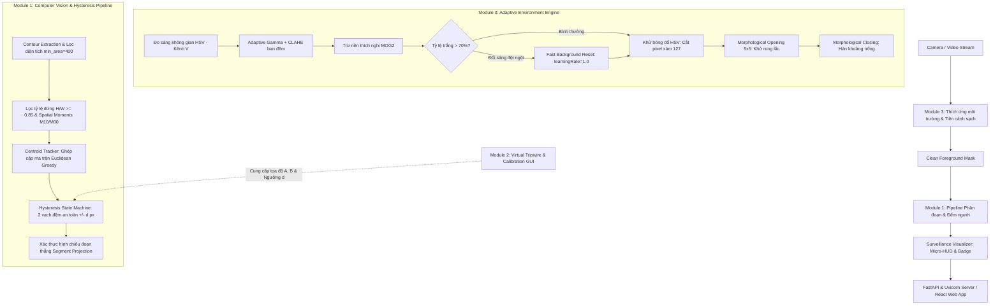

# 🛡️ HumanCheck: Intelligent Surveillance & Pure DIP People Counter

[](https://www.python.org/)
[](https://fastapi.tiangolo.com/)
[-61DAFB.svg?logo=react&logoColor=black)](https://react.dev/)
[-5C3EE8.svg?logo=opencv&logoColor=white)](https://opencv.org/)
[-brightgreen.svg)](tests/)
[](#ii-kiến-trúc-hệ-thống-3-module-thuật-toán)

> **Môn học:** Xử lý ảnh (Digital Image Processing) — Học viện Công nghệ Bưu chính Viễn thông (PTIT HCM)  
> **Giảng viên hướng dẫn:** TS. Huỳnh Trung Trụ  
> **Sinh viên thực hiện:** ToanPhuc15062005

---

## 📌 I. Tổng quan đề tài

**HumanCheck** là hệ thống camera giám sát thông minh và đếm người qua lại hai chiều (Vào / Ra / Hiện diện trong phòng) được xây dựng hoàn toàn dựa trên **các nguyên lý Xử lý ảnh số cổ điển (Pure Digital Image Processing - DIP)**.

### 💡 Triết lý thiết kế cốt lõi (Pure DIP)
* ❌ **Không sử dụng Deep Learning / YOLO / CNN / AI Pre-trained weights**.
* ❌ **Không phụ thuộc GPU đắt đỏ**.
* ✅ **100% Giải thuật thị giác máy tính cổ điển:** Trừ nền vi sai thích nghi (Adaptive Background Subtraction), Không gian màu HSV, Biến đổi Gamma thích ứng kết hợp CLAHE, Phép toán hình thái học (Morphological Operations), Moments không gian (Spatial Moments), và Giải tích hình học vector (Vector Cross Product).
* ✅ **Hiệu năng cực cao:** Tốc độ xử lý đạt **60+ FPS** trực tiếp trên CPU phổ thông.

---

## 🏛️ II. Kiến trúc hệ thống 3 Module thuật toán

Hệ thống được thiết kế theo kiến trúc module hóa chặt chẽ, chia tách độc lập giữa xử lý thị giác, hình học không gian và thích ứng môi trường:



### 1. Module 1: Pipeline Thị giác, Theo dõi & Máy trạng thái Hysteresis
* **Phân đoạn dáng người (Human Segmentation):**
  * Lọc nhiễu vi chuyển động với diện tích tối thiểu ($S \ge 400 \text{ px}^2$).
  * Lọc tỷ lệ khung bao dáng đứng: $\text{Aspect Ratio} = \frac{H}{W} \in [0.85, 4.5]$.
  * Tính toán tâm thực thể bằng **Spatial Moments**:
    $$c_x = \frac{M_{10}}{M_{00}}, \quad c_y = \frac{M_{01}}{M_{00}}$$
* **Bộ theo dõi tâm đối tượng (Centroid Tracker):** Duy trì định danh (ID) bền vững qua các frame bằng ma trận khoảng cách Euclidean và thuật toán ghép cặp tối ưu Greedy.
* **Máy trạng thái Hysteresis chống đếm trùng:**
  * Dựng 2 đường biên an toàn song song cách vạch chính khoảng cách $\pm d$ pixel.
  * Đối tượng chỉ được tính một lượt mới sau khi đã di chuyển thoát ra khỏi vùng đệm an toàn (`has_reached_safe_zone = True`), triệt tiêu 100% hiện tượng đếm lặp khi người đứng do dự, lắc lư hoặc quay đầu gần vạch.

### 2. Module 2: Giải tích hình học vạch ảo & Hiệu chỉnh tương tác
* **Khoảng cách trực giao có dấu (Signed Orthogonal Distance):**
  $$d(P, AB) = \frac{(x_2 - x_1)(y_P - y_1) - (y_2 - y_1)(x_P - x_1)}{\sqrt{(x_2 - x_1)^2 + (y_2 - y_1)^2}}$$
  * Dấu của $d$ xác định chính xác đối tượng đang ở phía `IN_SIDE` hay `OUT_SIDE`.
* **Xác thực hình chiếu đoạn thẳng (Segment Projection Factor):**
  $$t = \frac{(x_P - x_1)(x_2 - x_1) + (y_P - y_1)(y_2 - y_1)}{\|AB\|^2}$$
  Đảm bảo chỉ kích hoạt sự kiện khi đối tượng đi qua đoạn giới hạn giữa $A$ và $B$ ($t \in [-0.35, 1.35]$), loại bỏ hoàn toàn việc đếm nhầm người đi ngoài hành lang.
* **Bộ cấu hình tương tác:** Hỗ trợ kéo thả trực tiếp trên khung hình Web hoặc công cụ OpenCV Calibrator, lưu trữ tự động vào `tripwire_config.json`.

### 3. Module 3: 5 Trụ cột thích ứng môi trường (Adaptive Environment Engine)
1. **Thiếu sáng ban đêm:** Đo độ chói trung bình trên kênh V của không gian màu HSV; tự động kích hoạt **Adaptive Gamma Correction** qua bảng tra cứu nhanh LUT kết hợp **Cân bằng tương phản thích nghi CLAHE**.
2. **Trừ nền thích nghi:** Mô hình Gaussian Hỗn hợp MOG2 tự động cập nhật nền theo thời gian $B_t = \alpha B_{t-1} + (1-\alpha) I_t$.
3. **Đổi sáng đột ngột (Fast Background Reset):** Khi bật/tắt đèn làm tỷ lệ pixel trắng tăng vọt ($> 70\%$), hệ thống ép học lại nền ngay lập tức với `learningRate = 1.0`.
4. **Khử bóng đổ người:** Tách biệt và loại bỏ hoàn toàn các pixel bóng xám (giá trị 127) do MOG2 sinh ra.
5. **Khử rung lắc camera/lá cây:** Phép toán mở hình thái học (**Morphological Opening**) với kernel $5 \times 5$ loại bỏ nhiễu hạt, kết hợp **Morphological Closing** hàn kín thân người.

---

## 💻 III. Giao diện người dùng & Trình diễn

Hệ thống cung cấp 2 tầng giao diện độc lập:

### 1. Swiss Luxury Suite (Web React 18 + FastAPI)
* Thiết kế theo phong cách tối giản cao cấp Thụy Sĩ: tông màu Obsidian/Slate, chuẩn lưới 8pt, font chữ kỹ thuật Inter & JetBrains Mono, sử dụng 100% vector Lucide icons.
* Tích hợp 2 luồng video MJPEG đồng thời: **Camera HUD Stream** và **Clean Mask Stream**.
* Đồng bộ chỉ số thời gian thực qua **WebSocket (10Hz)**: Occupancy, Ingress, Egress, FPS, Độ sáng môi trường.
* Tương tác kéo thả chuột căn chỉnh vạch phân cách trực tiếp trên video với Pointer Events API mượt mà trên mọi mức zoom.
* Nút điều khiển Play/Pause luồng video và nút xuất nhật ký sự kiện ra file CSV.

### 2. Streamlit Interactive Prototyping
* Dashboard trực quan phục vụ nghiên cứu thử nghiệm tham số thuật toán, xem biểu đồ và kiểm thử nhanh.

---

## 🚀 IV. Hướng dẫn cài đặt & Khởi chạy

### 1. Yêu cầu môi trường
* **Python:** 3.10 trở lên.
* **Node.js:** 18.0 trở lên (để chạy frontend dev).

### 2. Cài đặt thư viện
```bash
# Clone repository
git clone https://github.com/ToanPhuc15062005/HumanCheck.git
cd HumanCheck

# Cài đặt Python dependencies
pip install -r requirements.txt

# Cài đặt Frontend dependencies (nếu cần phát triển giao diện)
cd frontend
npm install
cd ..
```

### 3. Các chế độ khởi chạy (Bộ điều phối `run.py`)

Hệ thống cung cấp script điều phối trung tâm [run.py](file:///c:/Users/TOAN%20PHUC/Desktop/python/HumanCheck/run.py):

| Chế độ | Lệnh thực thi | Cổng truy cập | Mô tả |
| :--- | :--- | :---: | :--- |
| **Full-stack API (Khuyên dùng)** | `python run.py --mode=api` | `http://localhost:8000` | Máy chủ FastAPI tích hợp sẵn cả REST API, WebSocket và bản build React SPA |
| **React Dev Server** | `python run.py --mode=frontend` | `http://localhost:5173` | Chạy môi trường phát triển Vite React độc lập |
| **Streamlit Demo** | `python run.py --mode=demo` | `http://localhost:8501` | Dashboard nghiên cứu & tinh chỉnh tham số thị giác |
| **Hiệu chuẩn vạch ảo** | `python run.py --mode=calibrate` | Cửa sổ OpenCV | Bấm chọn 2 điểm trên video để vẽ vạch tripwire |
| **Kiểm thử tự động** | `python run.py --mode=test` | Console | Chạy toàn bộ 12 ca kiểm thử Unit & Integration Tests |

---

## 📡 V. Danh mục REST API & WebSocket

FastAPI cung cấp hệ thống endpoint chuẩn RESTful:

| Phương thức | Đường dẫn | Chức năng |
| :---: | :--- | :--- |
| `GET` | `/health` | Kiểm tra tình trạng hoạt động của hệ thống |
| `GET` | `/api/v1/stats` | Lấy telemetry số liệu đếm, FPS, môi trường |
| `GET` | `/api/v1/config` | Lấy tọa độ vạch và khoảng cách buffer hiện tại |
| `POST` | `/api/v1/config/tripwire` | Cập nhật tọa độ vạch mới `{"pt1": [x,y], "pt2": [x,y], "d_threshold": 35}` |
| `POST` | `/api/v1/stream/play` | Tiếp tục xử lý video |
| `POST` | `/api/v1/stream/pause` | Tạm dừng xử lý video |
| `POST` | `/api/v1/stream/toggle` | Đảo trạng thái Play / Pause |
| `POST` | `/api/v1/reset` | Đặt lại bộ đếm IN / OUT và tracker về 0 |
| `GET` | `/api/v1/stream/video` | Luồng phát video MJPEG trực tiếp kèm Micro-HUD |
| `GET` | `/api/v1/stream/mask` | Luồng phát mặt nạ tiền cảnh sạch (Clean Mask) MJPEG |
| `WS` | `/ws/stats` | WebSocket telemetry phát sóng thời gian thực tần số 10Hz |

---

## 🧪 VI. Kết quả kiểm thử tự động

Toàn bộ hệ thống được bảo chứng bằng bộ test suite tự động tại thư mục [tests/](tests/):

```bash
python run.py --mode=test
```
```text
Ran 12 tests in 0.877s

OK
[Dispatcher] Khởi chạy bộ kiểm thử tự động (Unit & Integration Tests)...
```

* `test_module1_segmentor`: Kiểm tra lọc diện tích, lọc tỷ lệ khung đứng và Spatial Moments.
* `test_module1_tracker`: Kiểm tra tính liên tục của ID và cơ chế hủy đối tượng khi biến mất.
* `test_module1_tripwire_and_hysteresis`: Kiểm tra máy trạng thái, chống đếm lặp khi dao động quanh vạch và giới hạn đoạn thẳng.
* `test_module2_geometry`: Kiểm tra tính toán pháp tuyến, khoảng cách có dấu và hệ số hình chiếu vô hướng $t$.
* `test_module3_adaptive_lighting`: Kiểm tra khả năng tự phát hiện thiếu sáng và kích hoạt Gamma + CLAHE.
* `test_module3_shadow_removal`: Kiểm tra khả năng triệt tiêu 100% pixel bóng xám 127.
* `test_unified_pipeline_integration`: Kiểm tra luồng tích hợp hoàn chỉnh 3 module chạy liên tục trên video giám sát thực tế.

---

## 📂 VII. Cấu trúc thư mục dự án

```text
HumanCheck/
├── app/
│   ├── demo_streamlit/             # Dashboard nghiên cứu Streamlit
│   │   └── app.py
│   └── server_uvicorn/             # Backend FastAPI & Uvicorn
│       ├── main.py                 # Entrypoint server & mount React SPA
│       ├── routes.py               # REST endpoints, MJPEG streaming & WebSocket
│       ├── schemas.py              # Pydantic DTOs
│       └── service.py              # Video surveillance worker thread
├── core/
│   ├── config.py                   # Cấu hình Pydantic toàn hệ thống
│   ├── module1_tracking/           # Module 1: Xử lý thị giác & Theo dõi
│   │   ├── pipeline.py             # Pipeline tích hợp Module 1
│   │   ├── segmentor.py            # Phân đoạn dáng người & Spatial Moments
│   │   ├── tracker.py              # Centroid Tracker (Euclidean Greedy)
│   │   ├── tripwire.py             # Máy trạng thái Hysteresis & Segment bounds
│   │   └── visualizer.py           # Bộ vẽ Micro-HUD và Bounding Box
│   ├── module2_tripwire_gui/       # Module 2: Vạch ảo & Hiệu chỉnh
│   │   ├── calibrator.py           # Bộ cân chỉnh tương tác chuột & lưu JSON
│   │   └── geometry.py             # Giải tích hình học vector & hình chiếu
│   └── module3_adaptive_env/       # Module 3: Thích ứng môi trường
│       ├── background_engine.py    # MOG2 & Fast Illumination Shock Reset
│       ├── engine.py               # Bộ điều phối môi trường
│       ├── lighting_adapter.py     # Tự động cân bằng sáng Gamma + CLAHE
│       └── shadow_filter.py        # Khử bóng đổ HSV & Morphological Opening
├── data/
│   ├── configs/                    # File cấu hình tripwire_config.json
│   └── samples/                    # Video giám sát mẫu (surveillance.avi)
├── frontend/                       # React 18 + Vite (Swiss Luxury Suite)
│   ├── src/
│   │   ├── App.jsx                 # Dashboard chính & Canvas tương tác vạch
│   │   └── index.css               # Design system & CSS Zoom 0.75
│   └── dist/                       # Production bundle tích hợp vào FastAPI
├── tests/                          # Bộ kiểm thử tự động
│   ├── test_full_pipeline.py
│   └── test_module1_legacy.py
├── run.py                          # Master Application Dispatcher
└── requirements.txt                # Thư viện phụ thuộc Python
```

---

## 📜 Giấy phép & Bản quyền
Được phát triển phục vụ mục đích học tập và nghiên cứu môn học Xử lý ảnh tại **Học viện Công nghệ Bưu chính Viễn thông (PTIT HCM)**. Mọi quyền được bảo lưu bởi nhóm tác giả và giảng viên phụ trách đề tài.